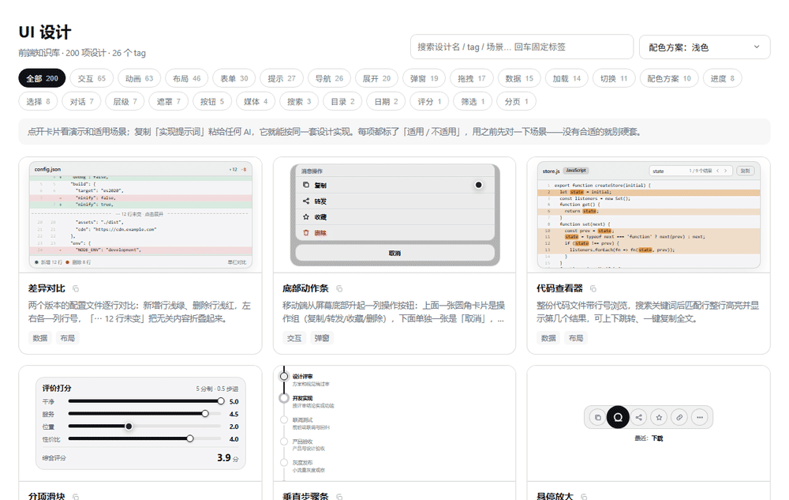
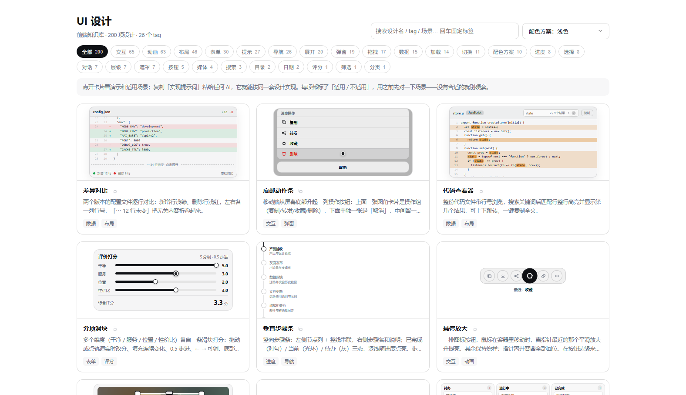
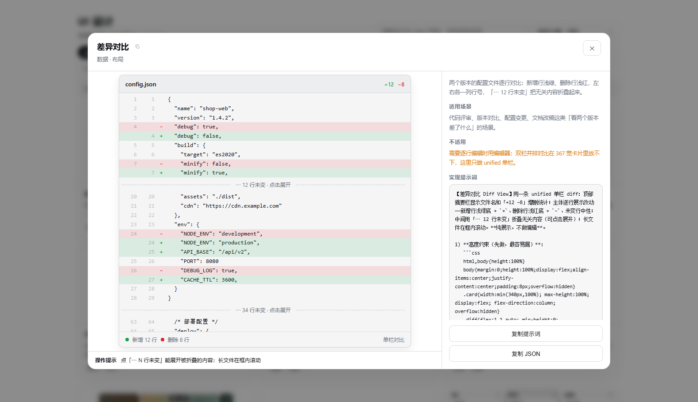
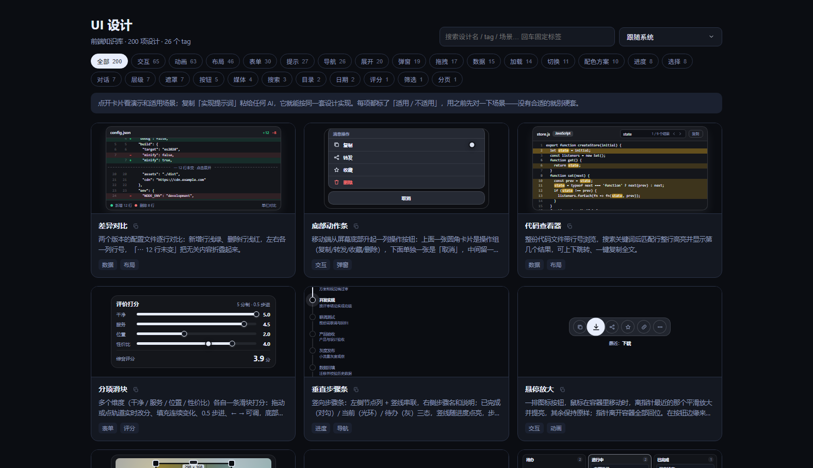

# DSH UI 设计知识库

[](https://www.npmjs.com/package/@philomelcc/dsh-ui-design)
[](./LICENSE)
[](https://github.com/philomelcc/dsh-ui-design/actions/workflows/ci.yml)

给 DeepSeek Harness（dsh）用的前端设计知识库：**200 项可复用设计**，每项带 tag、可交互 demo、适用/不适用场景和一套实现提示词。装进 dsh 后，agent 做前端 UI 任务前会先按场景检索，拿 demo 和 prompt 当实现依据；也带一个不用装 dsh 的纯静态展示版。



## 给谁用

- **给 AI 用**：agent 做页面/组件/动效前先搜（`ui_design search`），匹配到就取提示词和 demo 逐条实现；没有合适的就自己设计，不硬套。搜出来的每项都标了「适用 / 不适用」，先对场景再用。
- **给人用**：页面里按 tag 筛选、点卡片看可交互 demo、复制提示词丢给任何 AI，或复制 JSON。
- **不需要 dsh 也能看**：`site/` 是纯静态展示版，本地一行命令起服务，正式站规划在 [ui.philomel.cc](https://ui.philomel.cc)。

## 安装

```bash
dsh plugin --profile web add @philomelcc/dsh-ui-design
```

装好后重启一次 dsh web。入口有两种形态：

- 装了 `@philomelcc/dsh-workbench`：出现在工作台第二行的 tab「UI设计」；
- 没装工作台：出现在第一行系统栏（`sidebar.panellist`），点图标打开页面。

首次启动会把包内 `data/` 的 200 项设计写入 `~/.dsh/storages/ui-design/`，之后只读你的数据，不再覆盖。

## 界面

| 卡片网格 | 设计详情 |
| --- | --- |
|  |  |

卡片预览是真 iframe 跑 demo，不是截图。点开卡片：左边是可交互 demo + 操作提示，右边是摘要、适用场景、不适用、实现提示词，底部一键复制提示词 / JSON。

主题取自库里的「配色方案」设计（浅色、纸质、深色等 10 套），卡片预览也会跟着换色：



## agent 侧

插件注册一个 `ui_design` 工具：

| action | 作用 |
| --- | --- |
| `search` | 按场景/关键词搜候选（返回名称/tag/场景，不带 demo） |
| `get` | 取某项的完整提示词 + 适用场景（`includeDemo=true` 连 demo 代码一起） |
| `create` / `update` / `delete` | 新建 / 修改 / 删除设计（自然语言即可） |
| `guide` | 读《设计规范》（写 demo 前必读） |
| `tags` / `list` | 标签概览 / 分页浏览 |

系统提示会告诉 agent：**做前端 UI 任务前先搜索**；匹配后以 prompt 和 demo 为实现依据、逐条对照，不要凭印象简化。

## 展示版（不需要 dsh）

正式版会部署在个人网站 [ui.philomel.cc](https://ui.philomel.cc)（域名备案完成后上线）；本地预览：

```bash
npm run site        # 把 data/ 同步到 site/data/ 并起本地服务
# 或
node site/serve.mjs # 直接起，默认 http://127.0.0.1:3090
```

展示版功能：卡片网格（分页）、tag 筛选、标签输入搜索、弹窗 demo、复制标题/提示词/JSON、`配色方案` 直接作为主题切换。

## 检索

**默认零依赖**：关键词 + 同义词表（`data/synonyms.json`）+ 中文 2 字滑窗拆词 + 分层打分（name > aliases > tags > summary > usage）+ 字面兜底（bigram）。
装完就能搜，不需要任何外部服务。「对话框」能召回「弹窗」，「列表转圈」能召回加载类。

**可选：语义重排**。如果你有 OpenAI 兼容的 embedding 端点（本地 LM Studio / ollama / 自建都行），
在 `~/.dsh/storages/ui-design/config.json` 里配一下，`search` 会对关键词候选做一次向量重排：

```json
{
  "embedding": {
    "enabled": true,
    "endpoint": "http://127.0.0.1:1234/v1",
    "model": "text-embedding-nomic-embed-text-v1.5"
  }
}
```

- **没配就完全跳过**，行为和默认一致；
- 向量缓存写在 `~/.dsh/storages/ui-design/vectors.json`，设计内容变了自动重算那一条；
- 只对候选做重排（不是全库召回），一次查询只多一次 embedding 请求；
- 以后接本地 WASM embedding 时复用同一份 `embedTexts` / 缓存格式，配置项不变。

## 数据

- 包内 `data/`：初始设计库（`index.json` 元数据 + `designs/<id>.json` 单条完整内容），`synonyms.json` 是检索同义词表，别删。
- 运行时 `~/.dsh/storages/ui-design/`：同结构，你的增删改都在这里，升级不覆盖。
- 200 项时索引约 180KB，可一次加载；单条 demo 按需读取（2000 项时约 1.8MB，仍然能一次进内存）。

## 贡献

欢迎加设计、修 demo、提问题。提交前请读 [`设计规范.md`](./设计规范.md)——每项设计必须能通过「写 demo 前自检」那节，核心是：一项设计 = 可复用的界面模式，能在一个卡片里演示完；同模式换个排法不算新设计。

1. 加一项设计：在页面里「+ 新建设计」，或在任意 dsh 会话里说「新建一个设计：……」；
2. 导出到仓库：`node scripts/export-data.mjs`（把 `~/.dsh/storages/ui-design/` 同步回 `data/`）；
3. 跑 `node scripts/validate.mjs` 确认数据格式（CI 也会跑，ubuntu + windows 双平台）；
4. 提 PR。

## License

MIT
